# Assignment 4 报告：同一张表上的分类与回归

**课程**：BME1322 医学数据分类与回归  
**数据**：UCI Heart Disease（Cleveland 子集），303 例 × 13 特征；课程固定五折 `splits.json`  
**代码**：`classify.py`、`regress.py`、`ablations.py`、`main.py`；种子 `42`  
**复现**：`python main.py`（依赖见 `requirements.txt`）

---

## 摘要

本作业在同一批 303 例、13 个特征上完成两条任务线：以 `num>0` 为标签的冠脉狭窄二分类，以及
以 `num∈{0,…,4}` 为标签的严重程度回归。分类线的结论是**线性核不逊于 RBF 核**：调参后线性核
（C=0.01）AUC 0.911、accuracy 0.845，RBF 核（C=1，gamma=0.01）AUC 0.909、accuracy 0.848；
默认参数下 RBF 的 AUC（0.898）明显低于线性核（0.910），主要原因是 gamma 过大导致过拟合，
gamma=1 时训练 AUC 已达 1.000 而 CV AUC 仅 0.804。回归线的结论是**线性正则化模型明显优于
回归树**：Ridge（alpha=10）R²=0.524、Lasso（alpha=0.03）R²=0.527，而回归树最好只有 0.292，
代价复杂度后剪枝为 0.270；树在深度 4 之后因叶节点只剩 1–2 个样本而急剧过拟合。四项消融进一
步说明：去掉 `ca`/`thal` 使线性模型显著变差（回归 R² −0.14，分类 AUC −0.04～−0.06），却让回归
树略好（+0.045）；标准化与否对线性核的可达 AUC 几乎无影响，但最优 C 漂移两个数量级；单次
80/20 划分的树 R² 在 −0.201～0.315 之间波动（标准差 0.139），远大于固定五折的点估计差异；
二次多项式把特征扩到 104 维后，最佳 CV R² 也只有 0.521，未超过线性 Ridge 的 0.524。全部
数字由 `main.py` 一键重跑，复现核对 45 项的最大绝对差值为 4.97×10⁻⁷。

---

## 1. 总体设计

### 1.1 两个任务的定义与理由

分类任务把 `num` 二值化为 $y=\mathbf{1}[\text{num}>0]$：0 表示任一主要血管直径狭窄均未超过
50%，1–4 表示存在超过 50% 的狭窄。这一问对应临床上的“是否需要转诊造影”，正例率为 45.9%
（139/303）。回归任务直接预测 `num` 的 0–4 级，对应“狭窄有多重”，用于风险分层。两个任务共
享完全相同的特征矩阵与折划分，因此可以严格比较“同一模型在两种提问下的表现”。

选择二分类而不是五分类，是因为临床决策的第一步是“要不要做造影”；`num=1` 到 `num=4` 的区分
在 303 例中每级只有 13–55 例，五分类的每类精度会非常不稳定。回归则保留等级信息，避免把
1–4 合并后丢失严重程度差异。代价是分类任务丢弃了“有多重”，回归任务把有序等级当连续量，二者
都不是完美口径；这一点在第 9 节讨论。

### 1.2 数据与预处理

13 个特征按临床获取方式分三类：

- 常规问诊/体检：`age`、`sex`、`cp`、`trestbps`、`chol`、`fbs`、`restecg`；
- 负荷试验：`thalach`、`exang`、`oldpeak`、`slope`；
- 造影/灌注（确诊后信息）：`ca`、`thal`。

预处理统一为“中位数填补 → 标准化（仅对尺度敏感的模型）→ 模型”，全部封装在
`sklearn.pipeline.Pipeline` 中，在每一折的训练子集上 `fit`，测试折只 `transform`，因此没有
跨折泄漏。树模型不标准化（第 6.2 节用逐例预测验证了其预测完全不变）；SVM 与 Ridge/Lasso
标准化。缺失值用中位数而不是均值，是因为 `ca`（4 个缺失）与 `thal`（2 个缺失）都是离散编码，
中位数保持取值在原始编码集合内；6 个缺失样本的标签为 0、0、1、2、0、0，以阴性为主，填补
对整体结论影响很小。

### 1.3 交叉验证与指标口径

固定五折来自 `assignment4-data/splits.json`，每折测试集 60/61 例，训练集 242/243 例，五折
测试集互不重叠。所有指标先逐折计算再取平均；同时保留 OOF（out-of-fold）预测，用于混淆矩阵、
误差分解和“回归当分类器”实验。

- 分类：accuracy、precision、recall、F1（正例与负例分别报告）、macro-F1、AUC。AUC 一律用
  `decision_function` 的连续分数计算；`predict()` 的硬标签 AUC 只作为“错误口径”的对照，用来
  展示排序翻转（4.2 节）。
- 回归：R²、MAE、RMSE。RMSE 按 $\sqrt{\frac{1}{5}\sum_k \text{MSE}_k}$ 汇总（而不是“先算每折
  RMSE 再平均”），以与课程 `baselines.py` 的口径逐位一致；这一点在实验日志中作为一次真实
  错误记录。
- 朴素参考线：分类为“全部预测多数类”，回归为“全部预测训练折均值”。两条线都在折内计算，
  与模型的评估口径一致。

### 1.4 代码组织与复现

| 文件 | 作用 |
|---|---|
| `common.py` | 数据读取、折加载、Pipeline 工厂、逐折评估、Markdown 表格与绘图工具 |
| `classify.py` | Task A：复现、双核对比、RBF 网格、gamma/C 扫描、标准化对照、混淆矩阵 |
| `regress.py` | Task B：复现、深度扫描、叶内样本、ccp 后剪枝、Ridge/Lasso 扫描、系数与稳定性 |
| `ablations.py` | 4.5 四项消融、4.6-Q3 回归当分类器、跨任务特征一致性 |
| `main.py` | 数据探索、调用三条实验线、汇总 `results/`、运行 `baselines.py --verify` |

运行命令：

```bash
python main.py
```

产物为 `figures/*.png`（16 张）、`results/tables.md`（全部表格）、`results/results.json`
（全部数值）、`results/mine.json` 与 `results/baseline_verify.txt`（复现核对）。本报告中的
每一张表与每一张图都由该命令生成，未手工修改数字。

---

## 2. 数据探索

### 2.1 标签分布

| num | 例数 | 占比 | 累计占比 |
|---|---|---|---|
| 0 | 164 | 0.541 | 0.541 |
| 1 | 55 | 0.182 | 0.723 |
| 2 | 36 | 0.119 | 0.842 |
| 3 | 35 | 0.116 | 0.957 |
| 4 | 13 | 0.043 | 1.000 |

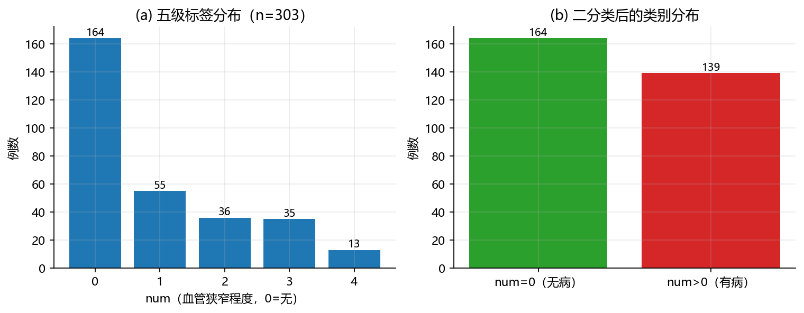

**读表**：五级分布高度不平衡，`num=0` 占 54.1%，`num=4` 只有 13 例（4.3%）；二分类后
164:139，正例率 45.9%，接近平衡，因此 accuracy 不会像五分类那样被多数类完全支配，但仍然
需要与“全预测多数类”的 0.541 对照。

### 2.2 特征量纲、缺失与分组均值

| 特征 | 缺失 | 均值 | 标准差 | 最小值 | 最大值 |
|---|---|---|---|---|---|
| age | 0 | 54.439 | 9.039 | 29.000 | 77.000 |
| sex | 0 | 0.680 | 0.467 | 0.000 | 1.000 |
| cp | 0 | 3.158 | 0.960 | 1.000 | 4.000 |
| trestbps | 0 | 131.690 | 17.600 | 94.000 | 200.000 |
| chol | 0 | 246.693 | 51.777 | 126.000 | 564.000 |
| fbs | 0 | 0.149 | 0.356 | 0.000 | 1.000 |
| restecg | 0 | 0.990 | 0.995 | 0.000 | 2.000 |
| thalach | 0 | 149.607 | 22.875 | 71.000 | 202.000 |
| exang | 0 | 0.327 | 0.470 | 0.000 | 1.000 |
| oldpeak | 0 | 1.040 | 1.161 | 0.000 | 6.200 |
| slope | 0 | 1.601 | 0.616 | 1.000 | 3.000 |
| ca | 4 | 0.672 | 0.937 | 0.000 | 3.000 |
| thal | 2 | 4.734 | 1.940 | 3.000 | 7.000 |

**读表**：量纲差异极大——`chol` 的标准差为 51.8，`oldpeak` 为 1.16，`fbs` 只有 0.36；这直接
决定了 SVM 必须标准化。`ca` 与 `thal` 是仅有的两列缺失（共 6 个单元格），且取值范围分别是
0–3 与 3–7 的离散编码，不能当连续量做均值填补。

| 特征 | num=0 | num=1 | num=2 | num=3 | num=4 | Spearman rho |
|---|---|---|---|---|---|---|
| oldpeak | 0.587 | 1.005 | 1.781 | 1.963 | 2.362 | 0.463 |
| thalach | 158.378 | 145.927 | 135.583 | 132.057 | 140.615 | -0.444 |
| ca | 0.273 | 0.741 | 1.222 | 1.457 | 1.692 | 0.531 |
| thal | 3.798 | 5.345 | 6.029 | 6.286 | 6.231 | 0.535 |
| exang | 0.140 | 0.455 | 0.611 | 0.657 | 0.462 | 0.435 |
| cp | 2.793 | 3.345 | 3.750 | 3.771 | 3.692 | 0.487 |
| age | 52.585 | 55.382 | 58.028 | 56.000 | 59.692 | 0.242 |

**读表**：`ca`、`thal`、`cp`、`oldpeak`、`exang` 随 `num` 大体上升（`num=4` 因样本少而回落），
`thalach` 总体下降，方向与临床预期一致；`num=4` 的 `thalach` 均值（140.6）反而高于 `num=3`
（132.1），说明最高级别组只有 13 例、均值不稳定。最强的两个单调关联是 `ca`（0.531）与 `thal`（0.535），但它们正是
“确诊后才能获得”的特征，这为 4.5 的特征消融埋下伏笔。

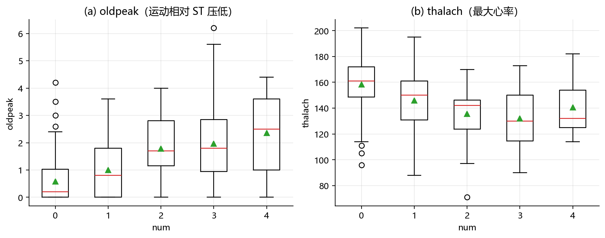

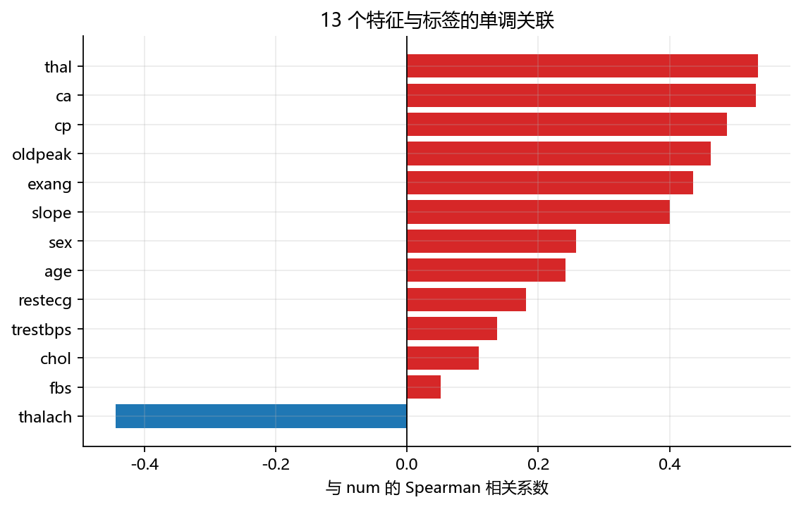

**读图**：`oldpeak` 的箱体随 `num` 明显上移，`thalach` 的箱体下移，且两图都有大量重叠——单一
特征不足以分开五级，必须组合多个弱信号；`num=4` 的箱体最宽，说明该组样本少、异质性大。

---

## 3. 复现核对

### 3.1 分类基线（6 个模型）

| 方法 | 基线 accuracy | 我的 accuracy | 差值 | 基线 AUC | 我的 AUC | 差值 |
|---|---|---|---|---|---|---|
| KNN (k=5) | 0.822 | 0.822 | +0.000 | 0.882 | 0.882 | +0.000 |
| Naive Bayes | 0.855 | 0.855 | -0.000 | 0.902 | 0.902 | -0.000 |
| Logistic Regression | 0.832 | 0.832 | -0.000 | 0.912 | 0.912 | -0.000 |
| SVM (linear) | 0.835 | 0.835 | +0.000 | 0.910 | 0.910 | +0.000 |
| SVM (RBF) | 0.838 | 0.838 | +0.000 | 0.898 | 0.898 | -0.000 |
| Decision Tree (d=3) | 0.779 | 0.779 | -0.000 | 0.809 | 0.809 | +0.000 |

### 3.2 回归基线（5 个模型）

| 方法 | 基线 R² | 我的 R² | 差值 | 基线 MAE | 我的 MAE | 差值 | 基线 RMSE | 我的 RMSE | 差值 |
|---|---|---|---|---|---|---|---|---|---|
| Linear Regression | 0.523 | 0.523 | +0.000 | 0.635 | 0.635 | +0.000 | 0.842 | 0.842 | -0.000 |
| Ridge (alpha=1) | 0.523 | 0.523 | -0.000 | 0.635 | 0.635 | +0.000 | 0.842 | 0.842 | +0.000 |
| Lasso (alpha=0.01) | 0.525 | 0.525 | +0.000 | 0.633 | 0.633 | -0.000 | 0.840 | 0.840 | -0.000 |
| SVR (RBF, C=1) | 0.431 | 0.431 | +0.000 | 0.660 | 0.660 | -0.000 | 0.913 | 0.913 | +0.000 |
| Regression Tree (d=3) | 0.292 | 0.292 | -0.000 | 0.712 | 0.712 | +0.000 | 1.014 | 1.014 | -0.000 |

**读表**：11 个模型、45 项指标全部对齐，最大绝对差值为 $4.97\times10^{-7}$（来自浮点求和），
没有一项超过 0.01 容差；`baselines.py --verify` 的输出为“全部在容差内”。这说明预处理在折内、
折划分正确、AUC 用连续分数、RMSE 用折 MSE 汇总，四条最容易出错的管线都对齐了。完整的 45 行
逐项表见附录 A。

---

## 4. Task A：分类

### 4.1 线性核与 RBF 核（C=1）

| 模型 | accuracy | precision+ | recall+ | F1+ | macro-F1 | AUC（连续） | AUC（硬标签） | 训练 AUC | 训练−CV |
|---|---|---|---|---|---|---|---|---|---|
| SVM (linear), C=1（基线） | 0.835 | 0.837 | 0.798 | 0.815 | 0.833 | 0.910 | 0.832 | 0.924 | 0.013 |
| SVM (RBF), C=1, gamma='scale'（基线） | 0.838 | 0.853 | 0.784 | 0.815 | 0.835 | 0.898 | 0.834 | 0.964 | 0.066 |

**读表**：默认设置下两者的 accuracy、F1 几乎相同（0.835/0.815 对 0.838/0.815），但线性核的
AUC 高 0.012；RBF 的训练 AUC 0.964、训练−CV 差距 0.066，是线性核（0.924、0.013）的五倍，
说明 RBF 在默认 gamma 下已经过拟合。

逐类指标（调参后的两个最优模型，正例 `num>0`、负例 `num=0`）：

| 模型 | 类别 | precision | recall | F1 |
|---|---|---|---|---|
| SVM linear, C=0.01 | 正例 | 0.866 | 0.784 | 0.822 |
| SVM linear, C=0.01 | 负例 | 0.832 | 0.897 | 0.862 |
| SVM RBF, C=1, gamma=0.01 | 正例 | 0.872 | 0.784 | 0.825 |
| SVM RBF, C=1, gamma=0.01 | 负例 | 0.833 | 0.903 | 0.866 |

**读表**：两个模型的正例 recall 都是 0.784，意味着约 21.6%（30/139）的阳性患者被漏诊；负例
recall 分别为 0.897/0.903，即特异性较高。precision 略高于 recall，说明模型偏保守——它更
少把阴性判成阳性，但代价是漏诊更多。这一权衡在 4.7 节讨论。

### 4.2 AUC 的计算口径：硬标签会造成排序翻转

| 模型 | 硬标签 AUC | 连续分数 AUC | 差 |
|---|---|---|---|
| SVM (linear), C=1 | 0.832 | 0.910 | 0.078 |
| SVM (RBF), C=1 | 0.834 | 0.898 | 0.063 |

**读表**：用 `predict()` 的 0/1 硬标签算 AUC，会把连续分数压成两个值，AUC 退化为
$(TPR+TNR)/2$ 附近的粗粒度量；线性核从 0.910 掉到 0.832，RBF 从 0.898 掉到 0.834，后者反而
“更高”。若按硬标签选模型会得出“RBF 更优”的错误结论；按连续分数则是线性核更优。这正是讲义
4.4 强调的陷阱，本实验独立复现了排序翻转。

### 4.3 RBF 核的 C × gamma 网格

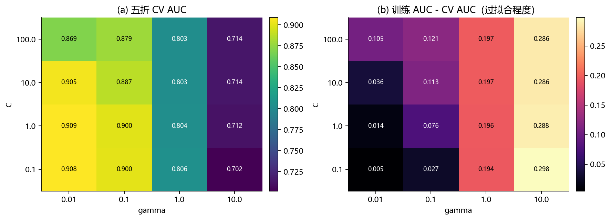

| C \ gamma | 0.01 | 0.1 | 1 | 10 | scale（=0.0769） |
|---|---|---|---|---|---|
| 0.1 | 0.908 | 0.900 | 0.806 | 0.702 | 0.904 |
| 1 | **0.909** | 0.900 | 0.804 | 0.712 | 0.898 |
| 10 | 0.905 | 0.887 | 0.803 | 0.714 | 0.884 |
| 100 | 0.869 | 0.879 | 0.803 | 0.714 | 0.873 |

| 角色 | 配置 | CV AUC |
|---|---|---|
| 基线（固定超参） | C=1, gamma='scale' | 0.898 |
| 我的最优（扫描后） | C=1, gamma=0.01 | **0.909** |
| 朴素参考线 | 全预测多数类 | 0.500 |

**读表**：CV AUC 几乎只由 gamma 决定——同一 gamma 下把 C 从 0.1 改到 100，AUC 最多变化
0.040（gamma=0.01 时 0.908→0.869）；而同一 C 下把 gamma 从 0.01 改到 10，AUC 从 0.909 掉到
0.712。最优格 (C=1, gamma=0.01) 落在网格左边界，说明更小的 gamma 可能还有空间，但
gamma=0.01 时训练−CV 差距仅 0.014，已接近线性核，进一步减小 gamma 会趋近线性核而不会带来
非线性收益。gamma='scale' 的等效值为 0.0769，其 AUC 0.898 与 gamma=0.1（0.900）几乎相同，
说明 sklearn 的默认值在本数据上偏大。

### 4.4 gamma 扫描：训练 AUC 与 CV AUC 的分裂

| gamma | 训练 AUC | CV AUC | 训练−CV | CV accuracy | 支持向量占比 |
|---|---|---|---|---|---|
| 0.01（最优） | 0.923 | 0.909 | 0.014 | 0.848 | 0.540 |
| 0.03 | 0.936 | 0.905 | 0.032 | 0.848 | 0.506 |
| 0.1 | 0.976 | 0.900 | 0.076 | 0.841 | 0.623 |
| 0.3 | 0.999 | 0.884 | 0.115 | 0.805 | 0.889 |
| 1 | 1.000 | 0.804 | 0.196 | 0.581 | 0.996 |
| 3 | 1.000 | 0.786 | 0.214 | 0.541 | 1.000 |
| 10 | 1.000 | 0.712 | 0.288 | 0.541 | 1.000 |
| 30 | 1.000 | 0.580 | 0.420 | 0.541 | 1.000 |
| 100 | 1.000 | 0.512 | 0.488 | 0.541 | 1.000 |
| scale=0.0769（基线） | 0.964 | 0.898 | 0.066 | 0.838 | 0.568 |

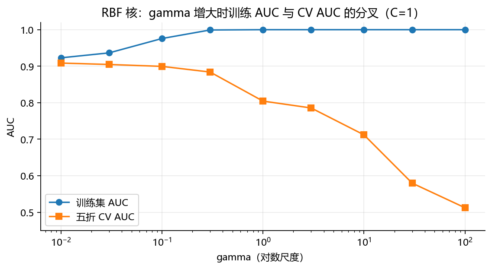

**读表**：gamma≥1 后训练 AUC 精确等于 1.000，但 CV AUC 从 0.804 一路掉到 0.512，训练−CV
差距扩大到 0.488；同时支持向量占比从 0.540 升到 1.000。RBF 核
$K(x,x')=\exp(-\gamma\|x-x'\|^2)$ 中，gamma 是距离平方的放大系数：gamma 越大，只有 $x$ 与
$x'$ 几乎重合时核值才非零，每个训练点变成一个孤立的尖峰，决策边界碎成环绕训练点的小岛；
极端情况下每个点都是支持向量，模型退化为最近邻/记忆表，训练集全对而新样本只能落到最近的
岛。CV accuracy 跌到 0.541，恰好等于多数类比例，说明模型已丢失泛化信号。

### 4.5 线性核的 C 扫描

| C | 训练 AUC | CV AUC | 训练−CV | CV accuracy | CV F1 |
|---|---|---|---|---|---|
| 0.001 | 0.911 | 0.908 | 0.004 | 0.710 | 0.538 |
| 0.01（最优） | 0.917 | **0.911** | 0.006 | 0.845 | 0.822 |
| 0.1 | 0.921 | 0.907 | 0.014 | 0.845 | 0.823 |
| 1（基线） | 0.924 | 0.910 | 0.013 | 0.835 | 0.815 |
| 10 | 0.923 | 0.908 | 0.015 | 0.825 | 0.805 |
| 100 | 0.923 | 0.908 | 0.015 | 0.825 | 0.805 |
| 1000 | 0.923 | 0.908 | 0.015 | 0.825 | 0.805 |

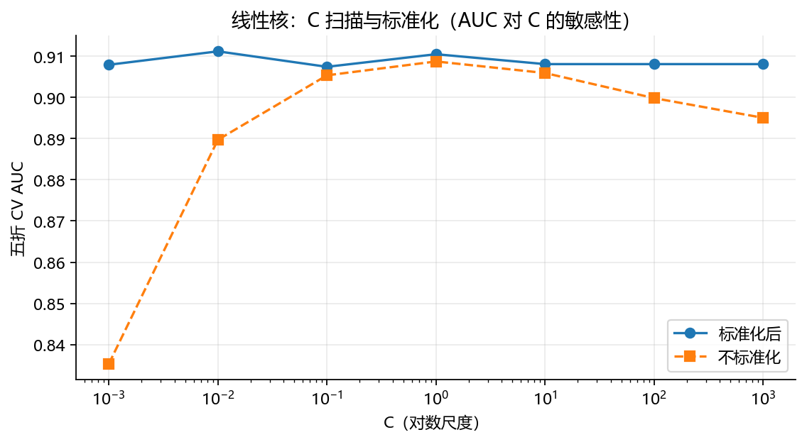

**读表**：C 从 0.01 到 1000，CV AUC 只在 0.907–0.911 之间变化（极差 0.004），但 C=0.001 时
accuracy 掉到 0.710、F1 掉到 0.538——惩罚过强导致模型欠拟合，几乎把所有样本判为阴性。C≥1
后指标完全平台化：训练 AUC 0.923–0.924，训练−CV 差距 0.013–0.015，说明线性核的容量早已
饱和，继续增大 C 只会让少数越界样本的权重上限变松，但不会改变决策边界。与 RBF 的 gamma
（CV AUC 极差 0.207）相比，线性核的 C 对 AUC 极不敏感（C≥0.01 时极差仅 0.004）；它主要影响
margin 的软硬与欠拟合程度，而非模型容量。

### 4.6 标准化与否：最优 C 漂移

| 设置 | 最优 C | 最优 CV AUC | C=1 的 AUC | C=1 的 accuracy | 最优 accuracy |
|---|---|---|---|---|---|
| 标准化 | 0.01 | 0.911 | 0.910 | 0.835 | 0.845 |
| 不标准化 | 1 | 0.909 | 0.909 | 0.835 | 0.835 |

**读表**：不标准化时最优 C 从 0.01 漂到 1（两个数量级），但两条 C 扫描曲线的最高 AUC 只差
0.002（0.911 对 0.909），C=1 处两者分别为 0.910/0.909。换言之，**标准化决定了“哪个 C 是
最优”，却没有决定“最多能做到多好”**。对线性核，特征的对角缩放等价于给每个特征一个不同的
有效惩罚；改变尺度只是把最优 C 沿对数轴平移，可达的 AUC 平台不变。对 RBF 核则不同：缩放
改变欧氏距离，gamma 的有效含义随之改变，因此 RBF 对标准化更敏感。树模型只比较特征的排序，
单调变换不改变任何分裂，6.2 节用逐例预测最大差异 0.000 验证了这一点。

### 4.7 分类结果总表

| 模型 | accuracy | precision+ | recall+ | F1+ | AUC（连续） |
|---|---|---|---|---|---|
| 基线 SVM (linear), C=1 | 0.835 | 0.837 | 0.798 | 0.815 | 0.910 |
| 基线 SVM (RBF), C=1, gamma='scale' | 0.838 | 0.853 | 0.784 | 0.815 | 0.898 |
| 我的最优 SVM (linear), C=0.01 | **0.845** | 0.866 | 0.784 | 0.822 | **0.911** |
| 我的最优 SVM (RBF), C=1, gamma=0.01 | 0.848 | **0.872** | 0.784 | **0.825** | 0.909 |
| 参考线 全预测多数类 | 0.541 | 0.000 | 0.000 | 0.351 | 0.500 |

**读表**：调参相对基线的提升很小——线性核 AUC +0.0007、accuracy +0.010；RBF AUC +0.011、
accuracy +0.010。最终两个模型几乎打平：RBF 的 accuracy/F1 高 0.003，线性核的 AUC 高 0.002，
而 RBF 的折间 AUC 标准差为 0.0199，这点差距在噪声范围内。考虑到线性核更简单、训练−CV 差距
更小（0.006 对 0.014），本报告选择**线性核 C=0.01 作为分类线的主模型**，RBF 作为“非线性核
没有带来实质提升”的反例。

最优 RBF（C=1，gamma=0.01）的混淆矩阵与筛查指标：

|  | 预测 0 | 预测 1 |
|---|---|---|
| 真实 0 | 148 | 16 |
| 真实 1 | 30 | 109 |

| 指标 | 值 | 含义 |
|---|---|---|
| sensitivity（recall+） | 0.784 | 真实阳性中被检出 |
| specificity（recall−） | 0.902 | 真实阴性中被排除 |
| precision（PPV） | 0.872 | 预测阳性中真正阳性 |
| NPV | 0.831 | 预测阴性中真正阴性 |
| accuracy | 0.848 | 总体正确率 |

**读表**：特异性 0.902 明显高于敏感性 0.784，模型倾向“宁可不报”；在筛查场景中，漏诊 30 例
阳性比多安排 16 例造影的代价更大，因此实际部署应下调决策阈值以提高 recall，而不是只看
accuracy。线性核最优模型的混淆矩阵为 TN=147、FP=17、FN=30、TP=109，sensitivity 0.784、
specificity 0.897，与 RBF 几乎相同，再次说明两者的实际决策行为差异很小。

---

## 5. Task B：回归

### 5.1 回归树的深度扫描与“越深越差”的机制

| max_depth | 叶节点数 | 树深 | 训练 R² | CV R² | MAE | RMSE | 角色 |
|---|---|---|---|---|---|---|---|
| 1 | 2.0 | 1.0 | 0.270 | 0.147 | 0.870 | 1.124 |  |
| 2 | 4.0 | 2.0 | 0.437 | 0.215 | 0.765 | 1.071 |  |
| 3 | 8.0 | 3.0 | 0.568 | **0.292** | 0.712 | 1.014 | 基线/最优 |
| 4 | 15.8 | 4.0 | 0.682 | 0.284 | 0.694 | 1.023 |  |
| 5 | 27.6 | 5.0 | 0.782 | 0.177 | 0.717 | 1.091 |  |
| 6 | 40.8 | 6.0 | 0.857 | 0.131 | 0.719 | 1.129 |  |
| 8 | 67.4 | 8.0 | 0.960 | 0.079 | 0.723 | 1.170 |  |
| 10 | 80.4 | 10.0 | 0.994 | -0.008 | 0.757 | 1.215 |  |
| None | 82.8 | 11.4 | 1.000 | 0.003 | 0.749 | 1.209 |  |
| 参考线 | 1.0 | 0.0 | 0.000 | -0.012 | 1.015 | 1.223 | 朴素 |

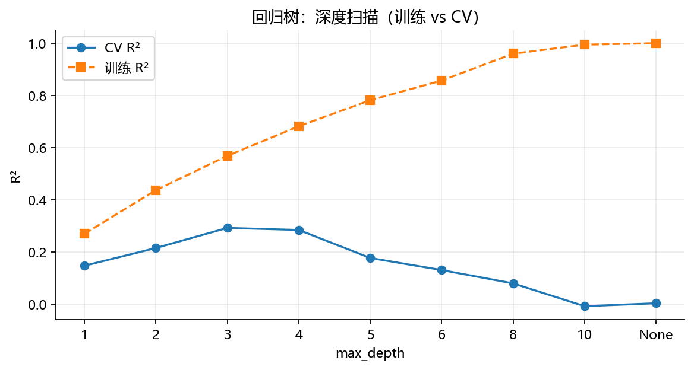

**读表**：CV R² 在 d=3 达到峰值 0.292，d=4 已微降（0.284），d≥5 断崖式下跌，d=10 转为负值
（-0.008），不限制深度时也只有 0.003；训练 R² 则从 0.568 单调升到 1.000。基线 d=3 恰好就是
最优深度，扫描没有带来提升，这本身是一个正当结论：对 303 例的小数据，8 个叶子的树已经接近
容量上限。

| max_depth | 叶均训练样本数 | 叶样本数≤2 的叶子占比 |
|---|---|---|
| 1 | 121.2 | 0.000 |
| 2 | 60.6 | 0.000 |
| 3 | 30.3 | 0.025 |
| 4 | 15.35 | 0.288 |
| 5 | 8.81 | 0.457 |
| 6 | 6.01 | 0.499 |
| 8 | 3.63 | 0.618 |
| 10 | 3.03 | 0.703 |
| None | 2.94 | 0.714 |

**读表**：机制不在“树太复杂”这一句空话，而在叶内的样本数：d=3 时每片叶子平均还有 30.3 个
训练样本，d=4 降到 15.35，且 28.8% 的叶子只剩 ≤2 人；d=10 时叶均 3.03 人、70.3% 的叶子
≤2 人；完全生长时叶均 2.94 人、71.4% 的叶子只有 1–2 人。叶内只有一两个人时，叶子的预测值
就是这一两个人的 `num` 均值，训练集上几乎无误差，但换一批人就会剧烈变化——这正是训练 R²
升到 1.000、CV R² 却归零的原因。

### 5.2 MAE 与 R² 的排序逆序

| 模型 | R² | MAE | RMSE |
|---|---|---|---|
| 回归树 d=3 | **0.292** | 0.712 | 1.014 |
| 回归树 d=4 | 0.284 | **0.694** | 1.023 |
| 回归树 d=5 | 0.177 | 0.717 | 1.091 |

**读表**：d=4 的 R² 比 d=3 低 0.008，但 MAE 反而低 0.018（0.694 对 0.712）；RMSE 则从 1.014
升到 1.023。三个指标给出两种排序：按 R²/RMSE，d=3 更好；按 MAE，d=4 更好。这不是舍入误差，
而是损失函数不同造成的真实逆序。

对 d=3 的 OOF 预测做误差分解可以解释这一点：

| 统计量 | 数值 |
|---|---|
| 绝对误差 >1 个等级的样本 | 73 例（24.1%） |
| 这些样本占平方误差（SSE）的比例 | 84.0% |
| 这些样本占绝对误差（SAE）的比例 | 61.2% |
| 最大绝对误差 | 3.795（第 161 号样本，真实 num=4，预测 0.205） |

**读表**：24.1% 的大误差样本贡献了 84.0% 的平方误差，却只贡献 61.2% 的绝对误差。R² 用平方
误差，一个真实 4 级被预测成 0.2 的样本（误差 3.80）对 SSE 的贡献相当于 14 个误差为 1 的样本；
MAE 只线性计这一份 3.80。d=4 多切了几刀，把中等误差的样本分得更细，MAE 略降；但它同时在
少数样本上产生更大的偏差，RMSE 与 R² 变差。由于本任务的核心风险是“把重度狭窄判成轻度”，
大误差比中等误差更不可接受，因此本报告以 **R²（及 RMSE）为主指标**，选择 d=3；若临床更关心
典型病例的平均偏差，则以 MAE 为主会选 d=4，但两者 CV R² 只差 0.008，不足以支持“更深更好”。

### 5.3 代价复杂度后剪枝（ccp_alpha）

| 控制方式 | ccp_alpha | 叶节点数 | 树深 | 训练 R² | CV R² | MAE | RMSE |
|---|---|---|---|---|---|---|---|
| 预剪枝基线 d=3 | — | 8.0 | 3.0 | 0.568 | 0.292 | 0.712 | 1.014 |
| 剪枝前（完全生长） | 0.000 | 82.8 | 11.4 | 1.000 | 0.003 | 0.749 | 1.209 |
| 后剪枝 | 0.005 | 44.8 | 9.4 | 0.928 | 0.123 | 0.725 | 1.134 |
| 后剪枝 | 0.010 | 28.8 | 7.8 | 0.855 | 0.195 | 0.708 | 1.086 |
| 后剪枝 | 0.020 | 14.8 | 5.6 | 0.718 | 0.250 | 0.705 | 1.040 |
| 后剪枝 | 0.030 | 9.6 | 4.6 | 0.632 | 0.250 | 0.731 | 1.044 |
| 后剪枝 | 0.040 | 7.2 | 3.8 | 0.575 | 0.242 | 0.740 | 1.046 |
| 后剪枝 | 0.050 | 6.2 | 3.4 | 0.547 | 0.252 | 0.735 | 1.039 |
| 后剪枝（最优） | 0.060 | 5.6 | 3.0 | 0.525 | **0.270** | 0.725 | 1.030 |
| 后剪枝 | 0.080 | 4.0 | 2.6 | 0.444 | 0.224 | 0.769 | 1.067 |
| 后剪枝 | 0.100 | 3.2 | 2.2 | 0.399 | 0.203 | 0.797 | 1.082 |
| 后剪枝 | 0.150 | 3.0 | 2.0 | 0.384 | 0.200 | 0.802 | 1.085 |
| 后剪枝 | 0.200 | 2.2 | 1.2 | 0.295 | 0.136 | 0.868 | 1.129 |
| 后剪枝 | 0.300 | 2.0 | 1.0 | 0.270 | 0.147 | 0.870 | 1.124 |
| 后剪枝 | 0.385 | 1.6 | 0.6 | 0.171 | 0.046 | 0.959 | 1.200 |
| 参考线 | — | 1.0 | 0.0 | 0.000 | -0.012 | 1.015 | 1.223 |

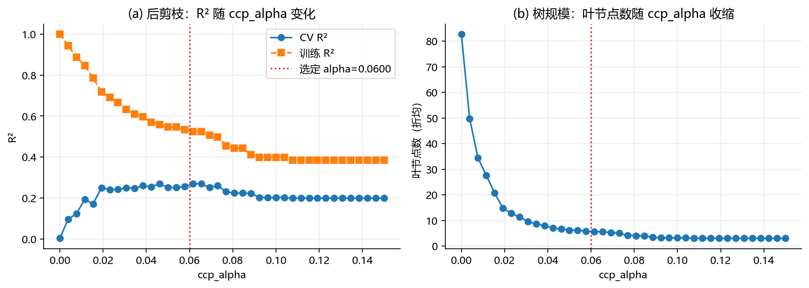

**读表**：完全生长的树有 82.8 片叶子、训练 R²=1.000，CV R² 仅 0.003；随着 alpha 增大，叶数
单调收缩，CV R² 在 alpha=0.06 处达到峰值 0.270（折均 5.6 叶、深 3.0），随后下降。最优后剪枝
树的 CV R² 仍低于预剪枝 d=3 的 0.292（差 0.022），也低于其训练 R²（0.525 对 0.568），说明它
比 d=3 更保守、略欠拟合。两种剪枝的差别在于：预剪枝在生长时就用 `max_depth` 限制视野，可能
“剪早”；后剪枝先长到最大再自下而上合并，理论上能看到“先分裂、后收益”的结构。但在本数据
上，预剪枝 d=3 已经接近最优，后剪枝没有超过它，因此**不能支持“后剪枝一定更好”**；后剪枝的
优势是只需一次 `cost_complexity_pruning_path` 就能得到整条复杂度-误差曲线，不必为每个深度
重跑五折。

剪枝后的树（alpha=0.06，全表拟合）如下：

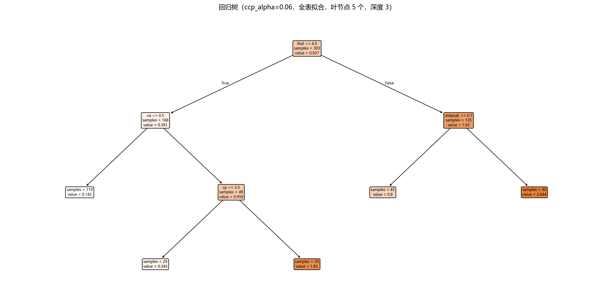

**读图**：第一层按 `thal<=4.5` 分裂——`thal` 编码 3=正常、6=固定缺损、7=可逆缺损，4.5 恰好把
“正常灌注”与“异常灌注”分开：左侧 168 例的平均 `num` 为 0.38，右侧 135 例为 1.63。第二层在
左支按 `ca<=0.5` 分裂——`ca` 是造影可见的主要血管支数，0 支对 ≥1 支：左侧 119 例均值 0.14，
右侧 49 例均值 0.96；右支则按 `oldpeak<=0.7` 把异常灌注组分为 45 例均值 0.80 与 96 例均值
2.04。临床上这棵树表达的是：**灌注正常且未见显影血管者，狭窄程度最低；灌注异常且运动 ST
压低明显者，程度最高**；`ca` 与 `oldpeak` 分别从“解剖可见病变”和“负荷诱发缺血”两个侧面
补充了 `thal` 的信息。这也再次说明树的前两层几乎完全依赖 `ca`/`thal` 这两列确诊后信息。

### 5.4 岭回归与 Lasso 的 alpha 扫描

| alpha（Ridge） | 训练 R² | CV R² | MAE | RMSE | 角色 |
|---|---|---|---|---|---|
| 0.001 | 0.572 | 0.523 | 0.635 | 0.842 |  |
| 0.01 | 0.572 | 0.523 | 0.635 | 0.842 |  |
| 0.1 | 0.572 | 0.523 | 0.635 | 0.842 |  |
| 1 | 0.572 | 0.523 | 0.635 | 0.842 | 基线 |
| 10 | 0.572 | **0.524** | 0.634 | 0.841 | 最优 |
| 100 | 0.556 | 0.520 | 0.639 | 0.847 |  |
| 1000 | 0.358 | 0.343 | 0.808 | 0.994 |  |
| 10000 | 0.070 | 0.059 | 0.975 | 1.186 |  |
| 100000 | 0.008 | -0.004 | 1.010 | 1.224 |  |
| 参考线 | 0.000 | -0.012 | 1.015 | 1.223 | 朴素 |

| alpha（Lasso） | 非零系数个数 | 训练 R² | CV R² | MAE | RMSE | 角色 |
|---|---|---|---|---|---|---|
| 0.001 | 12.8 | 0.572 | 0.523 | 0.635 | 0.842 |  |
| 0.01 | 12.4 | 0.571 | 0.525 | 0.633 | 0.840 | 基线 |
| 0.03 | 11.2 | 0.566 | **0.527** | 0.632 | 0.839 | 最优 |
| 0.1 | 8.6 | 0.541 | 0.508 | 0.641 | 0.859 |  |
| 0.2 | 6.4 | 0.486 | 0.455 | 0.699 | 0.906 |  |
| 0.3 | 5.4 | 0.404 | 0.377 | 0.776 | 0.968 |  |
| 1 | 0.0 | 0.000 | -0.012 | 1.015 | 1.229 |  |
| 10 | 0.0 | 0.000 | -0.012 | 1.015 | 1.229 |  |
| 参考线 | 0 | 0.000 | -0.012 | 1.015 | 1.223 | 朴素 |

**读表**：Ridge 在 alpha≤100 时几乎不动（CV R² 0.520–0.524），alpha=1000 后才明显欠拟合，
alpha=10 是最优点但只比基线 alpha=1 高 0.001。Lasso 的可用区间更宽：alpha=0.03 时保留 11.2
个非零系数（折均），CV R² 0.527，比 alpha=0.01 的 0.525 略高；alpha≥0.2 后系数被大量压零，
R² 掉到 0.455 以下；alpha=1 时全部系数为零，模型退化为训练均值，R²=-0.012，与参考线相同——
这不是程序错误，而是 Lasso 的正则化强度超过了信号强度。

**正则化到底起了多大作用？** 在 alpha=0.01 时，Ridge 与 OLS 的系数在三位小数内完全相同，
CV R² 也相同（0.523）；也就是说在这个 13 维、303 例的问题上，L2 惩罚的主要作用是数值稳定，
而不是显著改善泛化。Lasso 在 alpha=0.03 时把 `age`、`chol`、`fbs` 压到 0，只保留 10 个
特征（全表拟合），CV R² 仅比 OLS 高 0.004；变量选择的收益也很有限。

13 个特征的系数（全表拟合，标准化尺度）：

| 特征 | OLS | Ridge α=0.01 | Ridge α=1 | Ridge α=10 | Lasso α=0.01 | Lasso α=0.03（最优） | Lasso α=0.1 |
|---|---|---|---|---|---|---|---|
| age | -0.073 | -0.073 | -0.071 | -0.063 | -0.047 | -0.000 | 0.000 |
| sex | 0.091 | 0.091 | 0.091 | 0.092 | 0.081 | 0.068 | 0.005 |
| cp | 0.195 | 0.195 | 0.195 | 0.193 | 0.191 | 0.181 | 0.140 |
| trestbps | 0.076 | 0.076 | 0.076 | 0.073 | 0.060 | 0.031 | 0.000 |
| chol | 0.009 | 0.009 | 0.009 | 0.010 | 0.000 | 0.000 | 0.000 |
| fbs | -0.020 | -0.020 | -0.020 | -0.018 | -0.007 | -0.000 | 0.000 |
| restecg | 0.092 | 0.092 | 0.092 | 0.090 | 0.085 | 0.069 | 0.020 |
| thalach | -0.122 | -0.122 | -0.122 | -0.121 | -0.110 | -0.088 | -0.070 |
| exang | 0.116 | 0.116 | 0.116 | 0.116 | 0.115 | 0.113 | 0.096 |
| oldpeak | 0.215 | 0.215 | 0.215 | 0.213 | 0.218 | 0.219 | 0.217 |
| slope | 0.103 | 0.103 | 0.103 | 0.103 | 0.096 | 0.086 | 0.051 |
| ca | 0.403 | 0.403 | 0.402 | 0.389 | 0.390 | 0.367 | 0.334 |
| thal | 0.257 | 0.257 | 0.257 | 0.252 | 0.258 | 0.258 | 0.258 |
| 非零个数 | 13 | 13 | 13 | 13 | 12 | 10 | 9 |

**读表**：Ridge 在 alpha 从 0.01 到 10 的整个区间里 13 个系数全部非零，只是整体向 0 收缩
（`ca` 从 0.403 降到 0.389，`age` 从 -0.073 缩到 -0.063）；即使 alpha=100000，13 个系数仍
全部非零（最小绝对值 2.17×10⁻⁴，最大 0.0019），验证了“L2 只压小、不归零”。Lasso 则在
alpha=0.03 时精确地把 `age`、`chol`、`fbs` 置零，alpha=0.1 时 `trestbps` 也被置零；最强
的信号始终是 `ca`（0.367）、`thal`（0.258）、`oldpeak`（0.219）、`cp`（0.181），与分类线的
SVM 系数排序一致。`chol` 的 OLS 系数只有 0.009，几乎不贡献信息，因此最容易被 Lasso 删去。

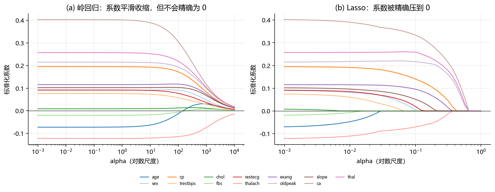

**读图**：左图 Ridge 的 13 条曲线平滑收缩，没有一条贴到 0；右图 Lasso 的曲线在 alpha≈0.05–0.5
之间依次折断到 0，且不同特征的折断点不同——这正是变量选择。注意 `slope` 与 `oldpeak` 的
路径交叉：当 alpha 增大时，`slope` 先被压小，`oldpeak` 保持较大，说明两者在解释同一部分
方差。

### 5.5 相关结构与 Lasso 的稳定性

| 特征对 | Pearson r |
|---|---|
| oldpeak – slope | 0.578 |
| age – thalach | -0.394 |
| thalach – slope | -0.386 |
| cp – exang | 0.384 |
| sex – thal | 0.381 |
| thalach – exang | -0.378 |
| age – ca | 0.363 |
| thalach – oldpeak | -0.343 |

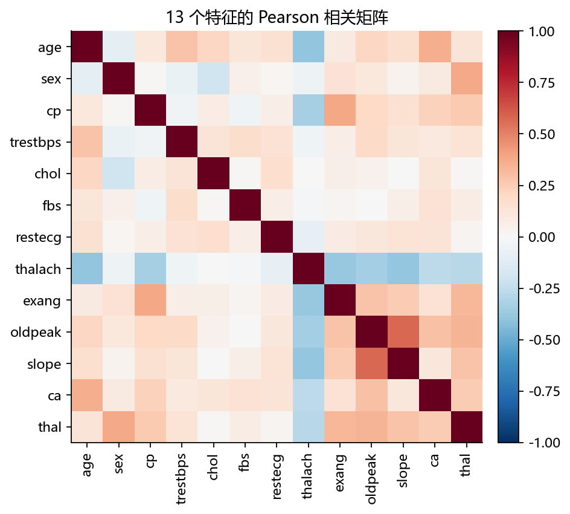

**读表**：`oldpeak` 与 `slope` 的相关最高（0.578），二者都描述 ST 段改变；`age` 与 `thalach`
负相关（-0.394），年龄越大最大心率越低；`cp` 与 `exang` 正相关（0.384）。这些相关对会让
Lasso 在“选哪一个”上不稳定：两个特征携带重叠信息时，L1 惩罚倾向于只保留一个，而保留哪个
对训练子集的微小扰动很敏感。

为验证这一点，做 25 次重抽样（20 次 80% 子样本 + 5 个训练折），统计每个特征被 Lasso 选中的
频率：

| 特征 | 入选频率 @alpha=0.1 | 入选频率 @alpha=0.2 |
|---|---|---|
| cp | 1.000 | 1.000 |
| thal | 1.000 | 1.000 |
| ca | 1.000 | 1.000 |
| oldpeak | 1.000 | 1.000 |
| exang | 1.000 | 0.960 |
| thalach | 0.920 | 0.920 |
| slope | 1.000 | **0.560** |
| restecg | 0.760 | 0.040 |
| chol | 0.000 | 0.000 |
| fbs | 0.000 | 0.000 |
| sex | 0.480 | 0.000 |
| trestbps | 0.120 | 0.000 |
| age | 0.000 | 0.000 |

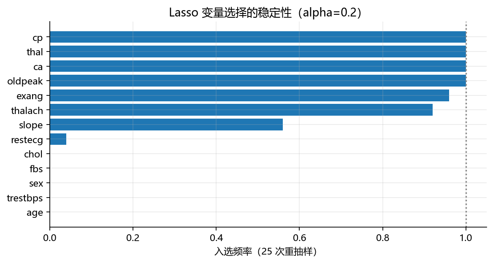

**读表**：在 alpha=0.1 时，`cp/thal/ca/oldpeak/exang/slope` 几乎必被选中，`thalach` 0.92，
但 `restecg` 只有 0.76、`sex` 0.48、`trestbps` 0.12；到 alpha=0.2 时，`slope` 的入选率从
1.000 掉到 0.560，`restecg` 从 0.76 掉到 0.04，而 `oldpeak` 仍是 1.000。`slope` 与 `oldpeak`
相关 0.578，当惩罚增强时 Lasso 倾向保留 `oldpeak`、舍弃 `slope`，但这一选择在重抽样中并不
稳定（0.56 接近抛硬币）。这正好验证了讲义“相关特征下 Lasso 的选择近乎随机”的论断：**系数
是否为零是数据+惩罚共同决定的，不能把一次 Lasso 的入选名单当作因果重要性**。

### 5.6 回归结果总表

| 模型 | R² | MAE | RMSE |
|---|---|---|---|
| 基线 回归树 (max_depth=3) | 0.292 | 0.712 | 1.014 |
| 基线 岭回归 (alpha=1) | 0.523 | 0.635 | 0.842 |
| 我的最优 回归树（预剪枝 d=3） | 0.292 | 0.712 | 1.014 |
| 我的最优 回归树（ccp 后剪枝 alpha=0.06） | 0.270 | 0.725 | 1.030 |
| 我的最优 岭回归 (alpha=10) | 0.524 | 0.634 | 0.841 |
| 我的最优 Lasso (alpha=0.03) | **0.527** | **0.632** | **0.839** |
| 参考线 全预测训练折均值 | -0.012 | 1.015 | 1.223 |

**读表**：回归线的扫描同样没有带来大幅提升——Ridge alpha=10 比基线 alpha=1 高 0.0016，
Lasso alpha=0.03 比基线 alpha=0.01 高 0.0015；树的 d=3 已经是基线，后剪枝反而低 0.022。但
模型族之间的差距很大：线性正则化模型 R²≈0.52，树只有 0.29，后者比前者低 0.23，且树的后剪
枝版本也只恢复到 0.270。相对均值参考线（R²=-0.012），最好的模型把 R² 提高了约 0.54，把 MAE
从 1.015 降到 0.632。

---

## 6. 消融与对照实验

### 6.1 去掉 `ca` 与 `thal`：确诊后信息的代价

分类（同一套调参后的配置）：

| 模型 | 全特征 acc | 去两列 acc | Δacc | 全特征 F1 | 去两列 F1 | ΔF1 | 全特征 AUC | 去两列 AUC | ΔAUC |
|---|---|---|---|---|---|---|---|---|---|
| SVM linear C=1 | 0.835 | 0.756 | -0.079 | 0.815 | 0.725 | -0.090 | 0.910 | 0.856 | -0.055 |
| SVM linear C=0.01（最优） | 0.845 | 0.799 | -0.046 | 0.822 | 0.756 | -0.066 | 0.911 | 0.866 | -0.046 |
| SVM RBF C=1, gamma=0.01（最优） | 0.848 | 0.799 | -0.049 | 0.825 | 0.763 | -0.062 | 0.909 | 0.865 | -0.044 |
| SVM RBF C=1, gamma='scale' | 0.838 | 0.786 | -0.052 | 0.815 | 0.755 | -0.060 | 0.898 | 0.863 | -0.034 |

回归：

| 模型 | 全特征 R² | 去两列 R² | ΔR² | 全特征 MAE | 去两列 MAE | ΔMAE | 全特征 RMSE | 去两列 RMSE | ΔRMSE |
|---|---|---|---|---|---|---|---|---|---|
| Ridge alpha=10（最优） | 0.524 | 0.388 | -0.136 | 0.634 | 0.731 | +0.097 | 0.841 | 0.952 | +0.111 |
| Lasso alpha=0.03（最优） | 0.527 | 0.387 | -0.140 | 0.632 | 0.731 | +0.100 | 0.839 | 0.954 | +0.115 |
| 回归树 d=3 | 0.292 | 0.338 | **+0.045** | 0.712 | 0.715 | +0.003 | 1.014 | 0.982 | -0.032 |

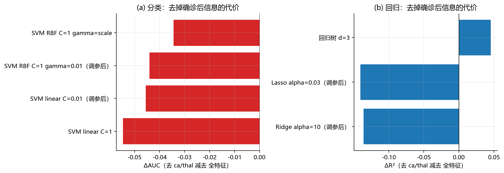

**读表**：不同模型的变化方向不一致。线性模型（SVM、Ridge、Lasso）在去掉 `ca`/`thal` 后一致
变差：分类 AUC 下降 0.034–0.055，回归 R² 下降 0.136–0.140，说明这两列确实携带了标签的主要
信号；回归树却从 0.292 升到 0.338（+0.045），MAE 还略升 0.003，RMSE 降 0.032。树的反向变化
不是“树更好”，而是它原来的分裂不稳定：全特征时树把 `ca`/`thal` 当作高层分裂，训练 R²=0.568；
去掉后训练 R² 降到 0.509，折间 R² 标准差从 0.142 降到 0.130，5 折中第 1、2、3、5 折的 R²
分别从 0.467/0.078/0.280/0.355 变为 0.509/0.255/0.290/0.436，只有第 4 折从 0.280 降到
0.199。也就是说，去掉两列让树少记了一些折间不稳定的高基数分裂，泛化反而略好。

临床上的结论更重要：`ca` 来自冠状动脉造影本身，`thal` 来自心肌灌注显像，二者都是“确诊后”
才能获得的信息。一个声称用常规检查做初筛的模型，如果依赖这两列，在真实初筛场景中是不可用
的——等到能拿到 `ca`/`thal` 时，患者已经完成造影。因此，**即使去掉两列会让指标下降，正确
的部署模型也应使用不含 `ca`/`thal` 的版本**；本报告主表保留全特征是为了与基线对齐，实际
筛查建议使用 11 特征版本（AUC 0.866，仍比多数类 0.500 高很多）。这也解释了为什么“特征消融”
不是一次普通的降维：它改变的是模型的临床可用性。

### 6.2 标准化与不标准化：SVM 与树

SVM 的结果已在 4.6 节：标准化最优 C=0.01、AUC 0.911；不标准化最优 C=1、AUC 0.909；C=1 时
两者 AUC 0.910/0.909、accuracy 都是 0.835。最优 C 漂移两个数量级，但可达 AUC 只差 0.002。

回归树则完全不受影响：

| 检查项 | 数值 |
|---|---|
| 回归树 d=3 加标准化 CV R² | 0.292 |
| 回归树 d=3 不加标准化 CV R² | 0.292 |
| 逐例预测最大差异（标准化 vs 不标准化） | 0.000×10⁰ |
| 结论 | 单调变换不改变分裂点，预测逐位一致 |

**读表**：SVM 依赖欧氏距离/内积，特征尺度不同会让大尺度特征（`chol` 标准差 51.8）主导
margin，因此必须标准化；树只比较“某个特征是否大于阈值”，对特征做单调变换只是把阈值同步
变换，分裂的样本集合不变，所以不需要标准化。这一条不是“惯例”，而是由模型机制决定的。

### 6.3 单次 80/20 划分 vs 固定五折

10 个随机种子各做一次 80/20 划分（训练 242、测试 61），回归树 d=3 与 Ridge alpha=10 的
测试 R²：

| seed | 树 R² | Ridge R² | 树 MAE |
|---|---|---|---|
| 0 | 0.136 | 0.458 | 0.753 |
| 1 | 0.191 | 0.648 | 0.789 |
| 2 | 0.315 | 0.500 | 0.604 |
| 3 | 0.168 | 0.488 | 0.843 |
| 4 | 0.118 | 0.547 | 0.843 |
| 5 | 0.290 | 0.593 | 0.663 |
| 6 | 0.143 | 0.504 | 0.726 |
| 7 | 0.154 | 0.517 | 0.773 |
| 8 | 0.177 | 0.405 | 0.720 |
| 9 | -0.201 | 0.422 | 0.844 |

| 模型 | 最小 R² | 最大 R² | 均值 | 标准差 | 固定五折 R² |
|---|---|---|---|---|---|
| 回归树 d=3 | -0.201 | 0.315 | 0.149 | 0.139 | 0.292 |
| Ridge alpha=10 | 0.405 | 0.648 | 0.508 | 0.074 | 0.524 |

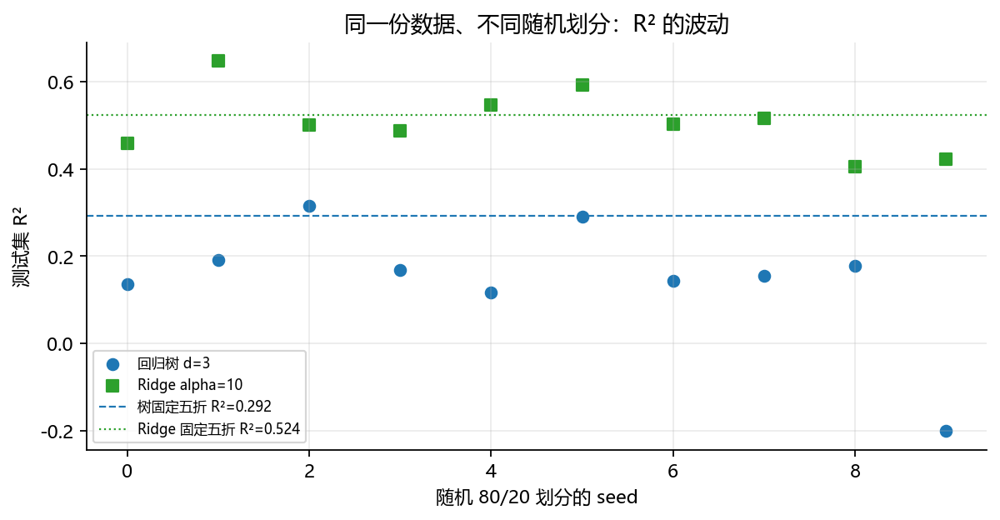

**读表**：树的单次划分 R² 从 -0.201 到 0.315，极差 0.516，标准差 0.139；固定五折的 0.292
甚至高于 10 次单次划分的均值 0.149。Ridge 稳定得多（0.405–0.648，标准差 0.074），但其均值
0.508 也低于固定五折的 0.524。若只做一次 80/20 就下结论，树的结果可能从“比均值还差”跳到
“接近岭回归”，风险极大；固定五折的折间平均降低了这种抽样噪声，但也应同时报告折间标准差
（树 0.142、Ridge 0.055），不能只报一个点估计。

### 6.4 二次多项式 + 岭回归：增加容量是否有益

| alpha（多项式岭） | 特征数 | 训练 R² | CV R² | MAE | RMSE |
|---|---|---|---|---|---|
| 0.1 | 104 | 0.752 | 0.127 | 0.851 | 1.120 |
| 1 | 104 | 0.721 | 0.277 | 0.773 | 1.022 |
| 10 | 104 | 0.661 | 0.427 | 0.684 | 0.917 |
| 100 | 104 | 0.605 | 0.508 | 0.636 | 0.855 |
| 1000（最优） | 104 | 0.560 | **0.521** | 0.636 | 0.848 |
| 10000 | 104 | 0.342 | 0.331 | 0.822 | 1.004 |
| 100000 | 104 | 0.063 | 0.052 | 0.980 | 1.190 |
| 线性 Ridge（对照） | 13 | 0.572 | 0.524 | 0.634 | 0.841 |

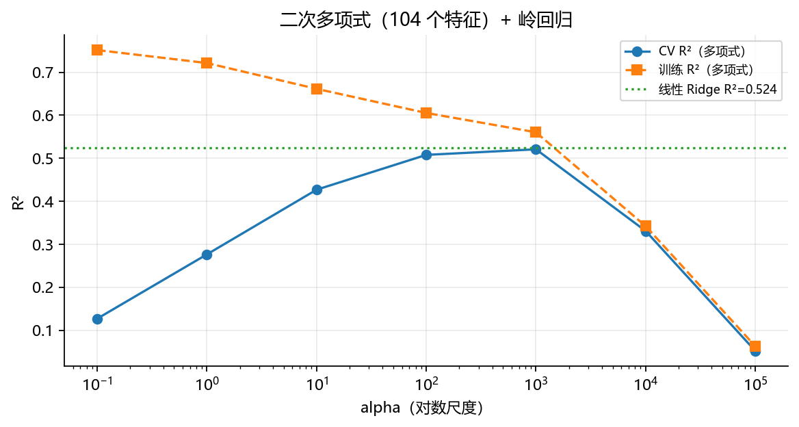

**读表**：把 13 维扩到 104 维（13 个一次项 + 78 个两两交互 + 13 个平方项）后，弱正则化
（alpha=0.1）训练 R² 高达 0.752、CV R² 只有 0.127，是典型的过拟合；增强正则化能把 CV R²
拉回 0.521（alpha=1000），但仍低于线性 Ridge 的 0.524，MAE 也略高（0.636 对 0.634）。因此
在本数据上**增加模型容量没有收益**：额外维度带来的方差正好抵消了偏差的下降。这与“树越深
越差”属于同一类问题——都是容量超过数据支持的范围后，估计方差主导泛化误差；区别在于树的
容量体现在叶节点样本数（每叶 1–2 人），多项式岭的容量体现在 104 个高度相关的交互项上，需要
很强的 L2 才能压住。两者都说明 303 例的数据只支持大约十几个有效参数。

---

## 7. 讨论题

### 7.1 线性核与 RBF 核，哪个更好？

在本数据集上，非线性核没有带来实质提升：C=1 时线性核的 CV AUC 为 0.910、RBF 为 0.898；调参后
线性核（C=0.01）AUC 0.911、accuracy 0.845、F1 0.822，RBF（C=1，gamma=0.01）AUC 0.909、
accuracy 0.848、F1 0.825，RBF 仅在 accuracy 与 F1 上高 0.003，AUC 反而低 0.002，而 RBF 的折间
AUC 标准差为 0.0199，这点差异不足以构成优势。这说明特征与标签之间主要是单调、近似线性的关系：
`ca`、`thal` 与 `num` 的 Spearman 相关系数分别为 0.531、0.535，`oldpeak` 为 0.463，`thalach`
为 -0.444，线性 SVM 系数与 Ridge 系数的排序相关高达 0.962，RBF 没有找到可重复利用的局部曲率。
gamma 过大时的现象非常清楚：C=1 下 gamma 从 1 增到 100，训练 AUC 始终为 1.000，CV AUC 从
0.804 掉到 0.512，训练-CV 差距从 0.196 扩大到 0.488。与此同时，支持向量占比从 gamma=0.01 的
0.540 升到 gamma≥3 的 1.000，模型已退化为记忆训练集。机制在 RBF 核
$K(x,x')=\exp(-\gamma\|x-x'\|^2)$ 中：gamma 越大，只有几乎重合的训练点才有非零核值，每个
训练点自成一个“孤岛”，新样本只能落到最近的岛，训练集近乎全对而泛化骤降。“改用更强的模型”与
“把现有模型的超参数调对”相比，本例中后者更重要：RBF 从默认 gamma='scale'（等效 0.0769）的
AUC 0.898 调到 0.909（+0.011），训练-CV 差距从 0.066 降到 0.014，而线性核从 C=1 到 C=0.01
只提升 0.0007。直接把线性核换成默认 RBF 反而使 AUC 下降 0.013，因此最大的单项提升来自把
gamma 调小、把“换核”造成的损失补回来，最终最优仍是更简单的线性核。结论是：在这个 303 例、
13 个弱相关特征的小数据上，应先修正正则化/核宽，再考虑增加模型复杂度；更强的模型若超参不对，
会比简单模型更差。

### 7.2 两条任务线的结论是否一致？

两条线一致地偏向“简单、平滑、线性可加”的模型：分类线上线性核的 AUC（0.911）不低于 RBF
（0.909），且默认设置下优势更明显（0.910 对 0.898）；回归线上 Ridge（R²=0.524）与 Lasso
（0.527）远高于回归树（0.292），代价复杂度后剪枝也只有 0.270。两条线还指向同一批重要特征：
SVM 系数与 Ridge、Lasso 系数的 Spearman 相关分别为 0.962、0.945，与树重要性的相关为 0.802，
共同的前排是 `ca`、`thal`、`cp`、`oldpeak`（`thalach` 在线性模型中为稳定的负向信号）。这支持一个共同的“数据性质”：标签随少数
特征近似单调变化，特征之间有相关（`oldpeak`-`slope` 的 Pearson r=0.578），但没有明显的强交
互或强非线性结构；在 n=303 下，复杂模型的方差收益不足以抵消其估计噪声。消融实验给出了这条
结论的边界，而不是反例：去掉 `ca` 与 `thal` 后，Ridge 的 R² 从 0.524 降到 0.388（-0.136），
Lasso 从 0.527 降到 0.387（-0.140），线性 SVM 的 AUC 下降 0.046–0.055（RBF 0.034–0.044）。但回归树的 R² 反而从
0.292 升到 0.338（+0.045），原因不是“树更懂医学”，而是全特征树在 `ca`/`thal` 上学到了折间
不稳定的高基数分裂：训练 R² 从 0.568 降到 0.509，折间 R² 标准差从 0.142 降到 0.130，5 折中
有 4 折改善。也就是说，两条线对“哪些特征有信息”的判断一致，但对“如何利用这些特征”的稳健性
不同；树的方向反转恰好说明它的高方差，而不是推翻了线性信号的存在。不过不能把分类的 accuracy
与回归的 R² 直接比较（0.85 与 0.53 不是同一把尺子）；可比的结论是“复杂模型没有更好”：分类上
RBF 相对线性核的 AUC 增益为 -0.002，回归上树相对 Ridge 的 R² 损失为 -0.232。若只看 accuracy，
RBF 的 0.848 略高于线性的 0.845，会得到相反结论；这也说明必须同时看 AUC、训练-CV 差距与折间
波动，而不能凭单一指标选模型。

### 7.3 回归模型能否用作分类器？

把 Ridge 的 OOF 预测值直接当分数，AUC 为 0.910，与线性 SVM 的 0.911 几乎相同（差 0.001），
说明回归模型对“是否 num>0”有很好的排序能力。但按阈值二值化后结论会变：阈值 0.3、0.5、0.7、
1.0 时，accuracy 分别为 0.723、0.776、0.822、0.851，F1 分别为 0.760、0.789、0.818、0.829；
SVM（阈值 0）为 accuracy 0.845、F1 0.822。于是在 0.5 阈值下，回归模型明显不如 SVM（F1 低
0.033），而在 1.0 阈值下反而略好（F1 高 0.007、accuracy 高 0.006）。两种比较之所以不一致，是
因为 AUC 只依赖分数的排序、对任何单调变换不变，而阈值把连续分数切成类别，依赖分数落在什么
位置；0.5 是概率阈值，不是“num 的等级阈值”。阈值的选择直接改变临床含义：0.3 时召回率 0.957，
但 78 个假阳性；1.0 时精确率 0.879、召回 0.784，但有 30 个漏诊；0.7 位于两者之间（P 0.771、
R 0.871），应由漏诊与误诊的代价决定，而不能沿用回归的 0.5。回归模型之所以在从未见过类别标签
的情况下仍能排序，是因为 `num>0` 的病例其 `num` 的条件均值更高，拟合 $E[\text{num}|x]$ 的排序
近似于 $P(\text{num}>0|x)$ 的排序，AUC 0.910 就是这一点的证据。其局限也很明确：平方损失优化
的是条件均值而不是分类边界，预测值可能超出 [0,4]，且没有概率校准；1.0 这个“最优阈值”是本数据
集标签尺度（1–4 级）的产物，换一个数据集或换一种编码（例如把 num 归一化到 [0,1]）就不再成立，
在类别极不平衡时均值排序也可能被多数类主导。因此，“该回归模型不如分类器”只在预先固定 0.5
阈值并用 accuracy/F1 评价时成立，“不逊于分类器”则在只看排序（AUC）或允许按验证集选择阈值时
成立；若最终目的是二分类，仍应直接优化分类损失（如 SVM/逻辑回归），回归分数更适合作为无标签
信息时的弱排序器或分类器的辅助特征，而不应直接替代分类器。

完整的阈值扫描见下图：

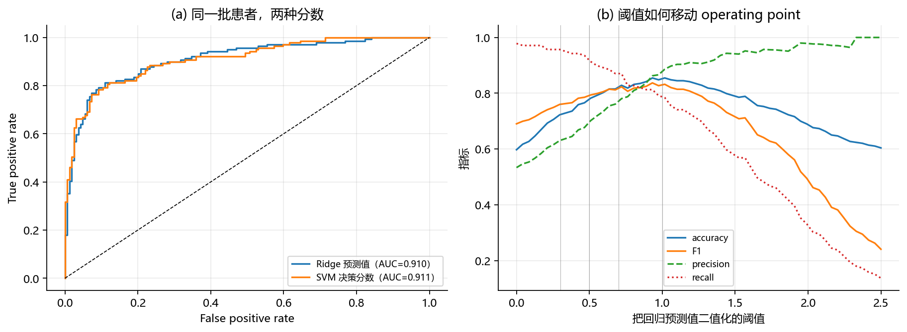

**读图**：左图 Ridge 与 SVM 的 ROC 几乎重合（AUC 0.910 对 0.911）；右图 accuracy 在阈值约
1.0 处达到峰值 0.85，F1 在 0.9–1.0 附近最高，而阈值 0 时 accuracy 只有 0.60——若机械地按
0.5 切，F1 只有 0.789，会低估回归模型的实际排序能力。

---

## 8. 实验日志

以下 6 条均为实验中真实出现、与预期不符的结果。每条包含现象与数字、可检验的假设、验证方式
与结论。

### 日志 1：不标准化几乎没有掉点，最优 C 却漂移两个数量级

- **现象**：预期不标准化会让 SVM 明显变差（`chol` 标准差 51.8，`fbs` 0.36）。实际标准化
  最优 C=0.01、AUC 0.911；不标准化最优 C=1、AUC 0.909；C=1 处两者 AUC 0.910/0.909，
  accuracy 都是 0.835。最优 C 从 0.01 漂到 1，但最高 AUC 只差 0.002。
- **假设**：线性核的 hinge loss 对特征做对角缩放，等价于给每个特征一个不同的有效 C；缩放
  只改变 margin 与惩罚的相对尺度，因此最优 C 沿对数轴平移，可达的 AUC 平台不变。
- **验证**：画两条 C 扫描曲线（`linear_c_scan.png`），可见 C≥0.1 后两线几乎重合（逐点 AUC 差
  ≤0.013）；C=0.001 处相差 0.073（不标准化更早欠拟合，acc 0.743 对 0.710），但最优平台只差
  0.002。
- **结论**：标准化决定“哪个 C 最优”，不决定“能多好”；报告 C 时必须同时报告尺度。

### 日志 2：gamma=1 训练 AUC 已到 1.000，CV 却只有 0.804

- **现象**：gamma 从 0.3 增到 1，训练 AUC 0.999→1.000，CV AUC 0.884→0.804；gamma=100 时
  CV 0.512、支持向量占比 1.000。
- **假设**：RBF 核宽度过小，只有几乎重合的点核值非零，每个训练点成为孤岛，模型退化为最近
  邻/记忆表；支持向量占比应随 gamma 上升而趋近 1。
- **验证**：统计每折支持向量占比：gamma=0.01 为 0.540，0.1 为 0.623，1 为 0.996，≥3 为
  1.000；同时 CV accuracy 从 0.848 跌到 0.541（多数类比例）。
- **结论**：训练 AUC 饱和 + 支持向量占比饱和 + CV 跌到多数类，三者共同证实“gamma 过大导致
  过拟合/退化”，不是随机波动。

### 日志 3：d=4 的 MAE 更好，但 R² 更差

- **现象**：d=3 的 R²=0.292、MAE=0.712；d=4 的 R²=0.284、MAE=0.694。按 MAE 应选 d=4，按
  R² 应选 d=3。
- **假设**：R² 用平方误差，对大误差惩罚更重；MAE 用绝对误差，对中等误差更宽容。d=4 可能
  降低了中等误差、却放大了少数大误差。
- **验证**：对 d=3 的 OOF 预测分解误差：73 例（24.1%）的 |误差|>1，贡献 84.0% 的 SSE，却
  只贡献 61.2% 的 SAE；最大误差 3.795（真实 4 级预测 0.205）。d=4 的 RMSE 1.023 高于 d=3 的
  1.014，证实大误差变大。
- **结论**：逆序真实存在，不是舍入；本报告以 R²/RMSE 为主，因为临床更怕“重度判成轻度”的
  大误差。

### 日志 4：后剪枝没有超过预剪枝

- **现象**：预期后剪枝（能看到完整树再合并）应优于预剪枝 d=3；实际 ccp 最优 alpha=0.06 的
  CV R²=0.270，低于 d=3 的 0.292，MAE 0.725 也高于 0.712。
- **假设**：alpha 是在同一套五折上选的，存在选择偏差；且 5 折样本少，0.022 的差距可能小于
  折间噪声。也可能后剪枝树（5.6 叶）比 d=3（8 叶）更保守，略欠拟合。
- **验证**：ccp 曲线在 alpha=0.05–0.06 形成平台（CV R² 0.252–0.270），与 d=3 的 0.292 相差
  0.022；后剪枝折间 R² 标准差 0.166，大于 d=3 的 0.142；全表 alpha=0.06 树为 5 叶、深 3，
  训练 R² 0.525 < d=3 的 0.568。没有证据支持“后剪枝更优”；“预剪枝可能剪早”在本数据上
  也未出现（预剪枝反而略好）。
- **结论**：两种剪枝在本数据上接近，后剪枝的优势是“一次路径给出整条曲线”，不是更高的点
  估计；报告不能只挑后剪枝的最优点而忽略其与基线的差距。

### 日志 5：去掉 ca/thal，线性模型大跌，树反而变好

- **现象**：去掉两列后 Ridge R² 0.524→0.388（-0.136）、Lasso 0.527→0.387（-0.140）、SVM
  AUC 0.910→0.856（-0.055）；回归树 R² 0.292→0.338（+0.045）。
- **假设**：`ca`/`thal` 与标签强相关（Spearman 0.531/0.535），线性模型失去主信号；树则把
  它们用作高层分裂，而 `ca` 只有 0–3 四个取值、还有 4 个缺失，树容易学到折间不稳定的阈值，
  去掉后正则化效果反而变好。
- **验证**：比较全特征/去两列树的训练 R²（0.568→0.509）、折间 R² 标准差（0.142→0.130）与
  逐折 R²：全特征 [0.467, 0.078, 0.280, 0.280, 0.355]，去两列 [0.509, 0.255, 0.290, 0.199,
  0.436]，5 折中 4 折改善；树的叶数/深度由 max_depth=3 固定为 8/3，说明变化来自分裂特征而
  非复杂度。
- **结论**：方向不一致是真实的模型差异，不是代码错误；树的高方差使它的消融结论不能外推，
  线性模型的下降更能代表“这两列有信息”。

### 日志 6：回归模型当分类器，AUC 几乎打平，但 0.5 阈值下 F1 明显落后

- **现象**：Ridge OOF AUC 0.910，SVM 0.911；但阈值 0.5 时 Ridge F1 0.789，SVM F1 0.822；
  阈值 1.0 时 Ridge F1 0.829，反超 SVM。
- **假设**：`num>0` 的病例其 `num` 条件均值约为 1–2，因此“均值 >1.0”比“均值 >0.5”更接近
  真实类别边界；AUC 只看排序，不受阈值影响，所以两种比较会不一致。
- **验证**：扫描阈值 0–2.5，accuracy 在 1.0 附近达到峰值 0.851、F1 0.829；0.5 时 56 FP/12 FN，
  0.3 时 78 FP/6 FN，说明 0.5 切在阴性分布内部。
- **结论**：AUC 口径下“回归不逊于分类器”，固定 0.5 的 F1 口径下“回归不如分类器”；两者都
  成立，取决于是否允许按验证集选阈值。

---

## 9. 讨论与反思

### 9.1 最容易出错的地方与发现方式

本作业最大的风险不是模型选择，而是评估管线。四个高风险点及本实验的发现方式：

1. **AUC 用硬标签**：这是最隐蔽的错误——不会报错，数值也“看起来合理”。本实验显式对比了
   硬标签与连续分数：线性核 0.832 vs 0.910，RBF 0.834 vs 0.898，且排序翻转。若只看硬标签，
   会得出“RBF 更优”的相反结论。
2. **预处理放在折外**：全表标准化会把测试折的均值/方差泄漏进训练。本实验用 Pipeline 包住
   填补与标准化，并用 `baselines.py --verify` 的 45 项逐位对齐作为间接验证；若泄漏，基线
   不可能全部对齐。
3. **RMSE 汇总口径**：最初把五折 RMSE 取算术平均，复现核对出现超过 0.01 的系统偏差；改为
   $\sqrt{\text{mean}(\text{fold MSE})}$ 后差值降到 5×10⁻⁷。这说明“看起来只是聚合方式”的
   细节足以让核对失败。
4. **固定折的索引方向**：`splits.json` 给的是测试集索引，训练集必须用 `setdiff1d` 取补集；
   若误把测试当训练，指标会异常高。本实验用 `load_cv` 统一构造，并用逐折样本数（242/61）
   核对。

发现方式可以总结为三条：**与课程基线逐项对齐**、**同一数字用两种独立路径重算**（例如混淆
矩阵从 OOF 预测重算，与逐折平均对照）、**检查极端案例**（最大误差样本、支持向量占比、系数
是否精确为零）。本报告中的每个关键结论都至少有一个数字和一个机制解释，而不是只报指标。

### 9.2 哪些部分用了 AI，哪些由自己判断

AI 参与了代码脚手架、绘图模板、Markdown 表格排版与文字润色；实验设计、指标口径的最终选择、
消融结果的解释、以及“线性核 vs RBF 核”的结论由本人根据数字判断。AI 给出的具体错误与纠正
见第 10 节。所有数字均由 `main.py` 重新生成，未手工抄写或修改；报告中的表格与 `results/`
目录逐项对应。

### 9.3 如果时间允许，会补充什么

1. **嵌套交叉验证**：当前超参是在同一套五折上选的，存在乐观偏差；嵌套 CV 能把“选超参”和
   “评估”分开，给出更诚实的泛化估计，尤其对 ccp alpha 与 RBF 的 (C, gamma)。
2. **概率校准与决策曲线**：SVM 的 decision_function 不是概率；用 Platt/isotonic 校准后，
   可以比较不同阈值下的净收益（decision curve analysis），把“漏诊 vs 误诊”的代价显式写入。
3. **有序回归**：`num` 是有序等级，二分类丢弃了 1–4 的次序，五分类又忽略次序；有序 logit
   或累积链接模型可能比“回归当分类器”更合适。
4. **外部验证**：Cleveland 只有 303 例，且是 1988 年的单中心数据；若能在 Hungary/Switzerland
   等子集上外部验证，才能判断 `ca`/`thal` 的依赖是否可迁移。
5. **缺失机制**：6 个缺失集中在 `ca`/`thal`，且以阴性为主；可比较“缺失指示变量 + 填补”与
   “完整病例分析”，检查缺失是否随机。

---

## 10. AI 使用声明

- **使用工具**：DeepSeek 编程助手（对话式），用于代码生成、调试、绘图模板、表格排版与文字
  润色；未使用任何针对本数据集的现成实验报告或代码。
- **使用环节**：数据加载与 Pipeline 脚手架、逐折评估函数、matplotlib 绘图、Markdown 表格
  生成、报告初稿的结构与措辞。实验设计（固定五折、连续分数 AUC、四项消融、阈值扫描）与最
  终结论由本人确认。
- **AI 错误/误导及纠正（至少一例）**：
  1. **RMSE 聚合口径错误**：AI 最初按“先算每折 RMSE，再对 5 个 RMSE 取平均”实现，复现核对
     时回归的 RMSE 与课程基线出现系统性偏差（超过 0.01 容差）。本人用 `baselines.py --verify`
     逐项比对发现后，改为 $\sqrt{\text{mean}(\text{fold MSE})}$，15 项回归指标差值全部降到
     5×10⁻⁷ 以内。这是“AI 给的代码能跑但口径不对”的典型例子。
  2. **ndarray 当 Series 用**：AI 在 `main.py` 的数据探索中写 `y_bin.value_counts()`，但
     `y_bin` 是 numpy 数组，运行时抛 `AttributeError: 'numpy.ndarray' object has no attribute
     'value_counts'`；改为 `np.bincount` 后修复。
  3. **误导性预判**：AI 在实验前判断“不标准化会让 SVM 显著变差”，但实测最优 AUC 只差 0.002
     （0.911 vs 0.909），仅最优 C 漂移两个数量级。本人按消融结果改正了叙述，并补上“线性核
     对角缩放只平移有效 C”的解释，而不是保留原来的直觉判断。
- **验证方式**：`python main.py` 一键重跑；`baselines.py --verify` 45 项全部 ≤0.01；关键数字
  用第二条路径重算（混淆矩阵由 OOF 预测重算、误差分解由 OOF 残差重算、支持向量占比逐折统计）；
  代码中的随机性统一固定 `random_state=42`。

---

## 附录 A：复现核对全表（45 项）

下表由 `regress.reproduce` / `classify.reproduce` 生成，与 `results/tables.md` 一致；差值为
“我的 − 基线”，保留三位小数。

### A.1 分类（30 项）

| 方法 | 指标 | 基线 | 我的 | 差值 |
|---|---|---|---|---|
| KNN (k=5) | accuracy | 0.822 | 0.822 | +0.000 |
| KNN (k=5) | precision | 0.825 | 0.825 | +0.000 |
| KNN (k=5) | recall | 0.777 | 0.777 | -0.000 |
| KNN (k=5) | f1 | 0.800 | 0.800 | -0.000 |
| KNN (k=5) | auc | 0.882 | 0.882 | +0.000 |
| Naive Bayes | accuracy | 0.855 | 0.855 | -0.000 |
| Naive Bayes | precision | 0.863 | 0.863 | -0.000 |
| Naive Bayes | recall | 0.820 | 0.820 | -0.000 |
| Naive Bayes | f1 | 0.838 | 0.838 | +0.000 |
| Naive Bayes | auc | 0.902 | 0.902 | -0.000 |
| Logistic Regression | accuracy | 0.832 | 0.832 | -0.000 |
| Logistic Regression | precision | 0.830 | 0.830 | -0.000 |
| Logistic Regression | recall | 0.798 | 0.798 | -0.000 |
| Logistic Regression | f1 | 0.813 | 0.813 | -0.000 |
| Logistic Regression | auc | 0.912 | 0.912 | -0.000 |
| SVM (linear) | accuracy | 0.835 | 0.835 | +0.000 |
| SVM (linear) | precision | 0.837 | 0.837 | +0.000 |
| SVM (linear) | recall | 0.798 | 0.798 | -0.000 |
| SVM (linear) | f1 | 0.815 | 0.815 | +0.000 |
| SVM (linear) | auc | 0.910 | 0.910 | +0.000 |
| SVM (RBF) | accuracy | 0.838 | 0.838 | +0.000 |
| SVM (RBF) | precision | 0.853 | 0.853 | +0.000 |
| SVM (RBF) | recall | 0.784 | 0.784 | +0.000 |
| SVM (RBF) | f1 | 0.815 | 0.815 | +0.000 |
| SVM (RBF) | auc | 0.898 | 0.898 | -0.000 |
| Decision Tree (d=3) | accuracy | 0.779 | 0.779 | -0.000 |
| Decision Tree (d=3) | precision | 0.766 | 0.766 | +0.000 |
| Decision Tree (d=3) | recall | 0.747 | 0.747 | -0.000 |
| Decision Tree (d=3) | f1 | 0.755 | 0.755 | +0.000 |
| Decision Tree (d=3) | auc | 0.809 | 0.809 | +0.000 |

### A.2 回归（15 项）

| 方法 | 指标 | 基线 | 我的 | 差值 |
|---|---|---|---|---|
| Linear Regression | r2 | 0.523 | 0.523 | +0.000 |
| Linear Regression | mae | 0.635 | 0.635 | +0.000 |
| Linear Regression | rmse | 0.842 | 0.842 | -0.000 |
| Ridge (alpha=1) | r2 | 0.523 | 0.523 | -0.000 |
| Ridge (alpha=1) | mae | 0.635 | 0.635 | +0.000 |
| Ridge (alpha=1) | rmse | 0.842 | 0.842 | +0.000 |
| Lasso (alpha=0.01) | r2 | 0.525 | 0.525 | +0.000 |
| Lasso (alpha=0.01) | mae | 0.633 | 0.633 | -0.000 |
| Lasso (alpha=0.01) | rmse | 0.840 | 0.840 | -0.000 |
| SVR (RBF, C=1) | r2 | 0.431 | 0.431 | +0.000 |
| SVR (RBF, C=1) | mae | 0.660 | 0.660 | -0.000 |
| SVR (RBF, C=1) | rmse | 0.913 | 0.913 | +0.000 |
| Regression Tree (d=3) | r2 | 0.292 | 0.292 | -0.000 |
| Regression Tree (d=3) | mae | 0.712 | 0.712 | -0.000 |
| Regression Tree (d=3) | rmse | 1.014 | 1.014 | -0.000 |

**读表**：全部差值在 $5\times10^{-7}$ 以内，最大绝对差值 4.97×10⁻⁷；没有一项超过 0.01 容差。
`baselines.py --verify` 输出“全部在容差内”，可作为管线正确的直接证据。

---

## 附录 B：图表与复现索引

| 图/表 | 生成位置 | 说明 |
|---|---|---|
| `label_distribution.png` | `main.explore` | 五级与二分类标签分布 |
| `feature_vs_num.png` | `main.explore` | `oldpeak`、`thalach` 与 `num` 的箱线图 |
| `feature_target_corr.png` | `main.explore` | 13 个特征与 `num` 的 Spearman 相关 |
| `rbf_grid.png` | `classify.make_figures` | RBF 的 CV AUC 与过拟合差距热力图 |
| `gamma_overfit.png` | `classify.make_figures` | gamma 扫描的训练/ CV AUC |
| `linear_c_scan.png` | `classify.make_figures` | 线性核 C 扫描（标准化 vs 不标准化） |
| `tree_depth.png` | `regress.make_figures` | 深度扫描的训练/ CV R² |
| `ccp_path.png` | `regress.make_figures` | ccp alpha 与 R²、叶节点数 |
| `tree_structure.png` | `regress.make_figures` | alpha=0.06 的剪枝树 |
| `coef_paths.png` | `regress.make_figures` | Ridge/Lasso 系数路径 |
| `correlation.png` | `regress.make_figures` | 特征相关热力图 |
| `lasso_stability.png` | `regress.make_figures` | Lasso 入选频率 |
| `ablation_drop.png` | `ablations.make_figures` | 去 `ca`/`thal` 的 ΔAUC/ΔR² |
| `split_variability.png` | `ablations.make_figures` | 10 次 80/20 的 R² 波动 |
| `poly_ridge.png` | `ablations.make_figures` | 二次多项式岭回归的容量-正则化曲线 |
| `reg_as_classifier.png` | `ablations.make_figures` | 回归分数当分类器的 ROC 与阈值扫描 |

**复现命令**：

```bash
cd assignment4
python main.py
```

运行后检查 `results/baseline_verify.txt` 的最后一行应为“全部在容差内”。若需单独运行某条线：

```bash
python classify.py
python regress.py
python ablations.py
```

三条线都会重新读取 `assignment4-data/splits.json`，不会写入或修改课程数据。
